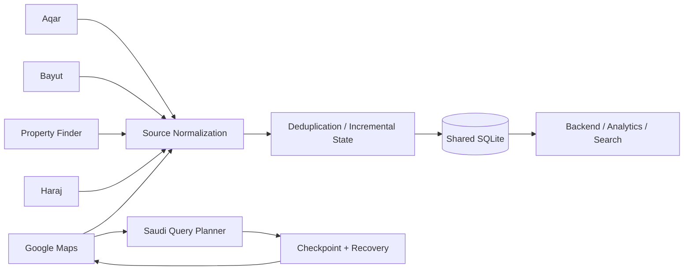

# Saudi Real-Estate Multi-Source Scraping & Data Pipeline

A production-oriented Python data pipeline for collecting and normalizing Saudi real-estate listings from multiple public web sources into a **single SQLite schema**.

The project combines **Playwright browser automation, HTML/JSON-LD parsing, authenticated session handling, incremental collection, deduplication, retry/recovery logic, nationwide Google Maps query planning, and shared persistence**.

> **Portfolio snapshot:** real credentials, browser sessions, phone/contact data, production databases, Google Maps screenshots, and collected customer/listing datasets are intentionally excluded.

## Project Scope

The supplied system contains collectors for:

- **Aqar**
- **Bayut Saudi**
- **Property Finder Saudi**
- **Haraj**
- **Google Maps**

Each source has different page structures, authentication behavior, pagination/scroll mechanics, and available fields. The engineering challenge was therefore not just extracting HTML; it was creating a resilient source-specific collection layer that writes into one normalized downstream database.

## What I Built

My work includes:

- Designing a shared SQLite schema for multiple Saudi real-estate sources.
- Building source-specific Playwright collectors and HTML parsers.
- Extracting listing details, price, area, location, features, media, advertiser metadata, and contact fields when legitimately visible.
- Reusing authenticated sessions where a source requires login.
- Supporting an Aqar login workflow with a user-controlled Telegram channel for receiving the OTP entered by the account owner.
- Detecting human-verification/access-restriction states and pausing/retrying instead of claiming successful collection.
- Opening detail pages only for newly discovered records on recurring cycles.
- Updating `last_seen_at` for existing listings instead of duplicating them.
- Building source-scoped uniqueness rules using listing IDs and canonical URLs.
- Creating a nationwide Google Maps query planner with restart checkpoints and query-level state.
- Implementing Google Maps scroll recovery, end-of-list evidence, retry scheduling, gallery diagnostics, and browser recycling.
- Preserving partial records and merging successful fields from later retries instead of discarding previously collected data.
- Keeping source-specific fields in JSON columns while maintaining a stable common schema.

## High-Level Architecture



## Why This Is More Than a Basic Scraper

A single selector-based scraper would not work reliably across these sources.

The project handles several different acquisition patterns:

| Source | Main techniques |
|---|---|
| Aqar | Playwright + BeautifulSoup, saved login session, OTP-assisted authenticated contact workflow, detail-page retry |
| Bayut | Playwright + HTML/JSON-LD parsing, gallery/property metadata extraction |
| Property Finder | Playwright + HTML parsing, detail pages, location/geo extraction, optional call-popup contact extraction |
| Haraj | Persistent Chromium profile, category + region filtering, load-more/scroll workflow, new-record-only detail extraction |
| Google Maps | Nationwide query planner, feed scrolling, map recovery, detail/gallery extraction, checkpoints, partial retry state |

## Incremental Collection Instead of Re-Scraping Everything

All collectors use the same idea:

```text
Discover listing
      ↓
Known source ID / URL?
   ┌──Yes───────────────┐
   │ update last_seen_at│
   │ skip detail work   │
   └────────────────────┘
      ↓ No
Open detail page
      ↓
Normalize source fields
      ↓
Insert into shared SQLite
```

This is important for long-running collection because later cycles spend most of their work on genuinely new records.

## Unified Data Model

The common `listings` table stores normalized fields such as:

- source / source listing ID
- property type and purpose
- title and canonical listing URL
- parsed price + original price text
- rent period
- area
- region / city / district / address fields
- location link
- description
- contact fields when available
- features
- images and videos
- advertiser/agent metadata
- first-seen / last-seen timestamps
- activity state

Source-specific structures remain available through JSON columns:

```text
details_json
features_json
images_json
videos_json
advertiser_json
```

See `docs/DATABASE_SCHEMA.md`.

## Google Maps: Nationwide Query Orchestration

The Google Maps component is the largest orchestration layer in this snapshot.

The current configuration contains:

- **13 Saudi administrative regions**
- **135 configured city/locality names**
- **148 geographic targets** including regional searches
- categories for chalet, camp, studio, and apartment
- daily/monthly variants where needed
- **840 unique queries per full configured sweep** after deduplication

The runner prioritizes Riyadh, then Jeddah, then the remaining configured locations.

> This is the number generated by the **current supplied configuration**. An older internal README referenced 882 queries; the current code/config produces 840 unique jobs after duplicate query strings are removed.

### Discovery and recovery

The Maps engine:

1. searches using the visible Google Maps UI;
2. scrolls the `role="feed"` result list;
3. saves discovered place links immediately;
4. detects literal end-of-list text when available;
5. monitors real scroll progress instead of trusting the spinner alone;
6. attempts controlled UI recovery when the feed stalls;
7. marks a query incomplete when it cannot prove completion;
8. resumes the next query instead of stopping the whole national cycle.

It does **not** implement CAPTCHA bypass. Access restrictions are recorded and the runner continues/retries safely.

## Checkpoints & Crash Recovery

The Google Maps runner stores:

- query-level status;
- current cycle ID;
- next query number;
- discovered place IDs;
- last attempt timestamps;
- errors and partial states.

If the process restarts, it can continue the incomplete cycle instead of starting Riyadh from zero.

The browser is also recycled after a configurable number of searches to limit memory growth.

## New-Only Detail Processing

Google Maps uses a separate discovery table before writing final listings.

A place may be:

```text
pending → done
        → error → retry after cooldown
        → partial → retry missing gallery/data later
```

Already-completed places are not reopened every cycle. Failed records can be retried after a shorter interval, while image-incomplete records use a longer retry window.

When a retry succeeds only partially, existing useful values/photos are merged rather than overwritten with null/empty data.

## Google Maps Detail Extraction

The detail pipeline can collect, when visible:

- title
- price / original price label
- rental period
- address and parsed city/district
- phone
- property/category label
- rooms / bathrooms / capacity-like specifications
- rating / review label
- amenities
- website / outbound booking links
- gallery image URLs
- video links
- coordinates / Plus Code / map metadata
- visible information sections and source-specific details

Missing fields remain `NULL`; the code does not fabricate values.

## Reliability Design

The project includes:

- page/detail retry loops;
- human-check/access-state detection;
- randomized pacing for source pages;
- session reuse;
- cycle state and timestamps;
- source-scoped duplicate protection;
- browser recycling;
- query checkpointing;
- database backup before Google Maps schema extensions;
- WAL-friendly shared SQLite usage;
- gallery diagnostics;
- error/partial status preservation;
- offline tests for Google Maps recovery logic.

## Offline Tests

The supplied Google Maps test suite validates, without calling Google Maps:

- spinner-visible scrolling does not falsely stop progress;
- end-of-list handling;
- category/geography order;
- missing price/phone remain `NULL`;
- shared-database source isolation and deduplication;
- SQL error recording;
- one failed city does not stop later city queries.

Run from the Google Maps folder:

```bash
python -m unittest tests.test_offline -v
```

The sanitized snapshot passes the offline suite.

## Tech Stack

- Python
- Playwright
- BeautifulSoup
- Requests
- SQLite
- asyncio
- JSON-LD / HTML parsing
- Pillow / NumPy for Maps diagnostics
- Telegram Bot API for the optional user-controlled Aqar OTP workflow

## Repository Structure

```text
scrapers/
  aqar_scraper.py
  bayut_scraper.py
  property_finder_scraper.py
  haraj_scraper.py
  find_telegram_chat_id.py

google_maps/
  saudi_maps.py
  maps_engine.py
  saudi_locations.json
  config.example.json
  tests/test_offline.py

docs/
  DATABASE_SCHEMA.md
  GOOGLE_MAPS_QUERY_PLANNER.md

examples/
  listing_sample.json
```

## Local Setup

```bash
python -m venv .venv
pip install -r requirements.txt
playwright install chromium
```

Copy `.env.example` to `.env` and provide only your own authorized credentials/session settings.

The non-Maps collectors can initialize/use the shared database through `REAL_ESTATE_DB_PATH`.

For Google Maps, copy:

```text
google_maps/config.example.json
```

to:

```text
google_maps/config.json
```

and set either `shared_db_path` there or `REAL_ESTATE_DB_PATH` in your environment. The Maps runner intentionally refuses to silently create a different database when it expects shared storage.

## Development Status

This is an **active, near-completion scraping/data-pipeline project**. The architecture, shared schema, incremental collectors, and Google Maps recovery/checkpoint layers are implemented and tested, but this repository does **not** claim that a complete nationwide Google Maps collection has already finished. Coverage is limited by what each public source exposes.

## Security & Data Handling

This public repository does not contain production contact data, databases, saved browser sessions, API tokens, or run artifacts.

See `SECURITY.md`.

## Author

**Hassan Ali Hassan**  
AI Engineer & Data Engineer  
Web Scraping, Browser Automation, Data Pipelines & Backend Integration
